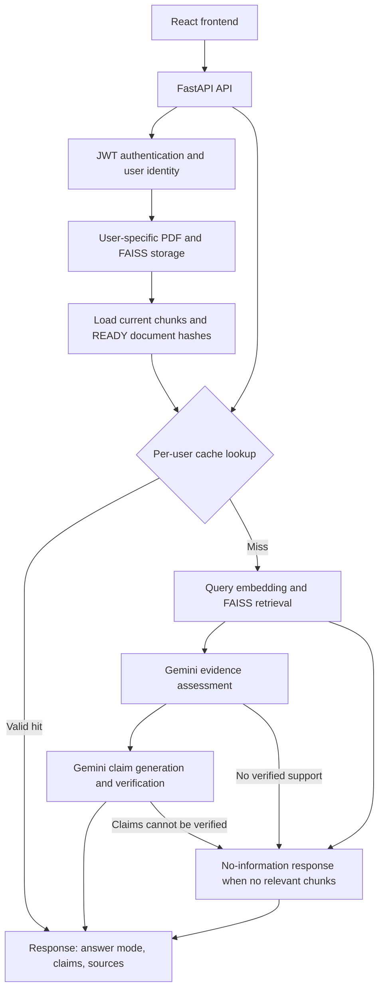
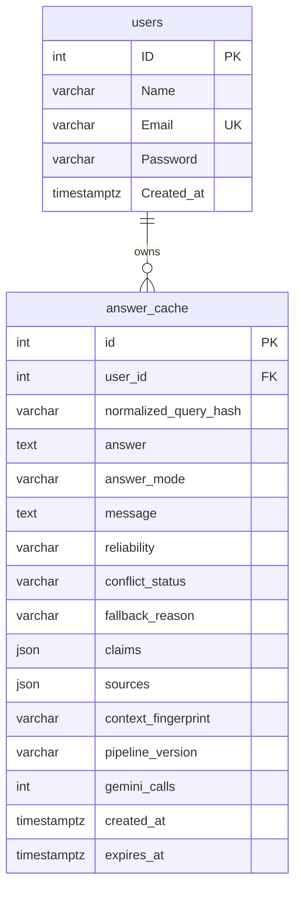

# Personalized AI Learning Assistant

A web application for asking questions about your own PDF study materials, with source excerpts and explicit answer modes.

> **Current scope:** account-based PDF upload and retrieval-augmented question answering. The application does not currently provide learner profiles, recommendations, assessments, mastery tracking, or adaptive learning.

## What it does

Students can create an account, upload PDFs, and ask questions about the material they have uploaded. The backend extracts text, builds a per-user FAISS index, retrieves passages for each question, and uses Gemini to assess evidence, draft claims, and verify the claims against their cited passages.

Responses distinguish among:

- **Document supported** ΓÇö claims are generated from retrieved passages and returned with source excerpts and claim-level citations.
- **Insufficient confidence** ΓÇö returned with a clear no-information message when no verifiable document-grounded answer can be produced. Gemini is never called to answer from general knowledge.
- **Temporary processing error** ΓÇö evidence-assessment or answer-generation API failures return HTTP 503 so they are not mistaken for missing document information.

Claim verification is model-assisted. The backend checks response structure and citation provenance, but cannot mathematically prove that a passage entails a claim or guarantee the modelΓÇÖs factual correctness.

## Current features

- Account signup, login, logout, and authenticated user lookup.
- JWT authentication in an HttpOnly cookie, with CSRF token checks and exact Origin validation for unsafe browser requests.
- PDF upload and text extraction by page using `pypdf`.
- Character-based text chunks (1,000 characters, with 200-character overlap) and local `all-MiniLM-L6-v2` embeddings.
- Per-user FAISS `IndexFlatL2` retrieval, currently limited to the five nearest chunks and a calibrated distance cutoff.
- Evidence assessment, claim generation, model-assisted claim verification, source excerpts, and disclosure of detected contradictions.
- Document-supported and no-information response modes; technical generation failures are returned as HTTP errors.
- Exact answer caching scoped to the user, normalized query, current retrieval context, and pipeline fingerprint.
- PostgreSQL persistence for account and answer-cache records, managed through Alembic migrations.

### Current API

| Method | Endpoint | Purpose |
|---|---|---|
| `GET` | `/users/csrf` | Bootstrap the browser CSRF token. |
| `POST` | `/users/signup` | Create an account. |
| `POST` | `/users/login` | Authenticate and set cookies. |
| `GET` | `/users/me` | Return the authenticated user profile. |
| `POST` | `/users/logout` | Expire authentication and CSRF cookies. |
| `POST` | `/documents/upload` | Upload and index one PDF for the authenticated user. |
| `POST` | `/chat/query` | Ask a question and receive an answer, mode, claims, and sources. |

### API examples

The following payloads are illustrative examples of the current schemas, not captured production data. Cookie-authenticated unsafe requests require the `access_token` HttpOnly cookie, the signed `csrf_token` cookie, an exact allowed `Origin`, and a matching `X-CSRF-Token` header. The frontend obtains the CSRF token from `GET /users/csrf` (or the successful login response), keeps the header value in memory, and sends requests with credentials. JavaScript does not read the JWT cookie.

#### Ask a question

`POST /chat/query` accepts a JSON body containing one `query` string:

```json
{
  "query": "What does gradient descent change during training?"
}
```

A representative document-supported response follows. `source.text` is a placeholder for an excerpt from the authenticated user's uploaded PDF.

```json
{
  "answer": "Gradient descent updates model parameters in the direction that reduces the loss.",
  "answer_mode": "DOCUMENT_SUPPORTED",
  "message": null,
  "reliability": "HIGH",
  "conflict_status": "NONE",
  "fallback_reason": null,
  "claims": [
    {
      "text": "Gradient descent updates model parameters in the direction that reduces the loss.",
      "classification": "SUPPORTED",
      "sources": [
        {
          "reference": "passage-example",
          "source": "course-notes.pdf",
          "page": 4,
          "text": "[Retrieved excerpt supporting this claim]"
        }
      ]
    }
  ],
  "sources": [
    {
      "reference": "passage-example",
      "source": "course-notes.pdf",
      "page": 4,
      "text": "[Retrieved excerpt supporting this claim]"
    }
  ]
}
```

If the user's documents do not provide relevant evidence, the API returns `INSUFFICIENT_CONFIDENCE`, no citations, and a plain-language message. If the documents contain only part of the answer, supported claims may be returned with a disclosure describing missing information. Gemini/API failures return HTTP 503. A document-supported label describes the selected pipeline path; model-assisted verification is not a guarantee of correctness.

For example, a no-information response has this shape:

```json
{
  "answer": "No relevant information was found in your uploaded documents to answer this question.",
  "answer_mode": "INSUFFICIENT_CONFIDENCE",
  "message": null,
  "reliability": "LOW",
  "conflict_status": "NONE",
  "fallback_reason": "NO_SUFFICIENT_DOCUMENT_EVIDENCE",
  "claims": [],
  "sources": []
}
```

#### Upload a PDF

`POST /documents/upload` expects `multipart/form-data` with a field named `file`. The browser frontend adds the authentication cookies and CSRF header automatically. For a manual client, provide the authenticated cookies, matching CSRF header, and allowed Origin as described above.

```text
Content-Disposition: form-data; name="file"; filename="course-notes.pdf"
Content-Type: application/pdf

[PDF file bytes]
```

On success the endpoint returns HTTP `201 Created`:

```json
{
  "message": "Document uploaded and processed successfully",
  "filename": "course-notes.pdf"
}
```

Verified errors include `400` for an empty/invalid filename, non-PDF extension, or invalid declared media type; `401` for missing or invalid authentication; `403` for a failed Origin/CSRF check; `409` when that user already has a document with the same filename; `422` when the required multipart `file` field is absent; and a generic `500` if storage or processing fails. The application currently has no upload-size limit.

## Usage walkthrough

1. Create an account or log in. The browser obtains a CSRF token before submitting unsafe requests.
2. Open **Documents** and upload a PDF. The interface reports the upload and indexing stages; processing extracts text and builds the user's index.
3. Wait for indexing to finish, then open the chat workspace.
4. Ask a question about the uploaded material.
5. Read the answer mode and disclosure. **Document supported** means claims were built from retrieved passages; **not found in your documents** means no verifiable document-supported answer was available. Technical API failures appear as retryable errors.
6. For document-supported claims, select a citation to inspect its source filename, page (when available), and retrieved excerpt.

Factual chat answers are limited to retrieved content from the authenticated user's uploaded documents.

## Application screenshots

No genuine application screenshots, GIFs, or videos are currently checked into the repository. Add screenshots here when captured from the running application; the following views would communicate the current workflow:

- Landing page.
- Login and signup interfaces.
- Main chat workspace.
- PDF upload and indexing workflow.
- Document-supported answer with citations and an excerpt open.
- No-information response when the uploaded documents do not answer the question.

## Architecture



The cache lookup follows loading the user's current index metadata and document hashes. A valid hit avoids query embedding, FAISS search, and Gemini calls. There is no broader-retrieval or general-knowledge fallback.

## RAG and document processing

1. The authenticated user uploads a PDF.
2. `pypdf` extracts text from pages. Pages with no extractable text do not produce chunks.
3. `RecursiveCharacterTextSplitter` splits each page into 1,000-character chunks with 200-character overlap; page and filename metadata are retained.
4. SentenceTransformers creates local embeddings. FAISS stores vectors in an `IndexFlatL2` index for that user.
5. A question is embedded and the five nearest chunks are retrieved. The calibrated squared-L2 cutoff is retained as a retrieval signal, but all top-five candidates reach evidence assessment because held-out threshold recall is limited.
6. Gemini assesses coverage, drafts claims from the retrieved passages, and separately verifies claims against their cited passages. The backend constructs citations from those retrieved passages and drops or qualifies claims according to verification.
7. If there is no relevant support or the generated claims cannot be verified, the API returns a no-information response. If an external model call fails, the API returns HTTP 503 instead of disguising the failure as missing information.

The cutoff was calibrated using a small synthetic retrieval fixture. It is not a guarantee of relevance for arbitrary user documents.

## Security and data isolation

- The authenticated identity comes from the server-validated JWT `sub` claim; request-supplied user IDs are not used to select a userΓÇÖs private store.
- JWTs are held in HttpOnly cookies and are not exposed to frontend JavaScript.
- Unsafe cookie-authenticated requests require a valid signed CSRF token and an exact configured Origin. CORS is configured with explicit origins and credentials.
- PDFs, indexes, chunks, and ingestion metadata are stored under user-specific local filesystem paths. Retrieval and cache queries are also scoped by user ID.
- PostgreSQL Row-Level Security is **not** implemented. Isolation is enforced in application logic and filesystem paths, not by RLS policies.
- The answer cache stores generated answers and source data in PostgreSQL. It must be treated as private user content.

These controls reduce accidental cross-user access but are not a claim of complete or production-certified security. Use an appropriately restricted database account in deployed environments.

## Answer cache

The cache uses a hash of the query after Unicode NFC normalization, whitespace collapsing, and case folding; punctuation remains significant. It is not semantic caching. Cache identity includes the authenticated user, hashes of all READY documents, and a fingerprint of the document-only prompts, model name, embedding model, retrieval metric, top-k, and threshold.

Before returning a cached document answer, the backend validates the response schema and checks that its source excerpts and claim citations match current chunks belonging to READY documents for that user. It may also cache legitimate no-information responses, but never technical failures. Cache entries expire after 24 hours by default; set `ANSWER_CACHE_TTL_SECONDS` to change the lifetime. Cache database errors fall back to the normal RAG path.

A cache lookup occurs after the current index/chunks and READY-document hashes are loaded, before query embedding and FAISS retrieval. A valid hit skips retrieval and Gemini calls. Any READY-document content change or pipeline change invalidates reuse; cache database errors proceed through normal retrieval and answering.

## Technology stack

### Runtime

- **Frontend:** React 18, React Router, Redux Toolkit, Axios, Parcel, CSS Modules, React Markdown.
- **API:** Python, FastAPI, Pydantic, SQLAlchemy, PyJWT, `pwdlib`.
- **Database and migrations:** PostgreSQL, SQLAlchemy, Alembic.
- **Document/RAG:** `pypdf`, LangChain text splitters, SentenceTransformers (`all-MiniLM-L6-v2`), FAISS CPU.
- **Generation:** Google Gen AI SDK and Gemini (`gemini-3.6-flash`, as configured in the current source).
- **Storage:** local filesystem for PDFs, FAISS indexes, chunks, and ingestion metadata.

### Development and tests

- Backend tests use Python `unittest` and FastAPIΓÇÖs test client.
- Frontend tests use Jest and React Testing Library.
- Retrieval and answer-validation evaluation scripts use JSON fixtures.

The project does not currently use a hosted vector database, Redis, or a recommendation model in its running application.

## Database schema

The current PostgreSQL schema contains account and exact-answer-cache records. The cache has a foreign key to its owning user and is deleted when that user row is deleted. The unique cache key is `(user_id, normalized_query_hash, context_fingerprint, pipeline_version)`; check constraints restrict cacheable answer modes and require a nonnegative `gemini_calls` value.



`users.ID` is an integer primary key; `Name` is `VARCHAR(100)`, `Email` is `VARCHAR(255)` with a unique index, `Password` is `VARCHAR(255)` containing a password hash, and `Created_at` is a timezone-aware timestamp defaulting to `now()`. `answer_cache` uses a 64-character query hash and context fingerprint, a 128-character pipeline version, JSON `claims` and `sources`, plus the other fields shown above. It also has an expiry index and an index on `user_id`. PDFs, FAISS indexes, chunks, and ingestion metadata are stored on the filesystem, not in PostgreSQL tables.

## Setup

### Prerequisites

- Python 3.10 or newer, with versions compatible with `Backend/requirements.txt`.
- PostgreSQL, with a database created for this application.
- Node.js and npm, with versions compatible with `Frontend/package-lock.json`.
- A Gemini API key for live answer generation.

### Backend

In PowerShell:

```powershell
cd Backend
py -m venv .venv
.\.venv\Scripts\Activate.ps1
python -m pip install --upgrade pip
pip install -r requirements.txt
Copy-Item .env.example .env
```

Edit `Backend/.env` and set the required values. The example file contains placeholders only; never commit real secrets.

| Variable | Purpose |
|---|---|
| `APP_ENV` | `development`, `test`, or `production`; must be explicit. |
| `DATABASE_URL` | SQLAlchemy PostgreSQL connection used by the API and Alembic. |
| `LLM_API_KEY` | Gemini API key. |
| `SECRET_KEY` | JWT signing secret. |
| `ALGORITHM` | JWT algorithm (the example uses `HS256`). |
| `ACCESS_TOKEN_EXPIRE_MINUTES` | JWT lifetime. |
| `CSRF_SECRET_KEY` | Dedicated random CSRF signing secret, at least 32 bytes and different from the JWT secret. |
| `CSRF_TOKEN_TTL_SECONDS` | CSRF token lifetime; default shown in the example is 3600 seconds. |
| `CORS_ALLOWED_ORIGINS` | Comma-separated exact frontend origins; production requires explicit origins. |
| `COOKIE_SECURE`, `COOKIE_SAMESITE`, `COOKIE_DOMAIN` | Cookie behavior; production requires secure cookies, and `SameSite=None` requires Secure. `COOKIE_DOMAIN` can be empty for local development. |
| `ANSWER_CACHE_TTL_SECONDS` | Answer-cache lifetime; default is 86400 seconds if unset. |

Generate secrets with a cryptographically secure random generator. Do not use example values or reuse the JWT key for CSRF signing.

Create the PostgreSQL database using your local PostgreSQL administration workflow, then put its SQLAlchemy URL in `DATABASE_URL`. The application does not provision PostgreSQL roles or databases automatically.

For a **new, empty database**, apply the existing migrations from the `Backend` directory:

```powershell
alembic upgrade head
alembic current
alembic history
```

For an **existing database that already has `public.users` but has no Alembic revision recorded**, do not run the baseline upgrade directly against that table. First compare its schema with `fa11c95537c7_baseline_users_schema.py`. If it matches the baseline, record only that baseline and then apply later revisions:

```powershell
alembic stamp fa11c95537c7
alembic upgrade head
alembic current
```

This allows Alembic to create later tables such as `answer_cache` without recreating `users`. Do not stamp `head` unless the existing database has been checked against every revision it would mark as applied.

Start the API from `Backend`:

```powershell
uvicorn App.main:app --reload
```

### Frontend

In a second terminal:

```powershell
cd Frontend
npm ci
Copy-Item .env.example .env
npm start
```

The Parcel development server defaults to `http://localhost:1234`. Set `API_BASE_URL` in `Frontend/.env` if the backend is at a different address. `CSRF_BOOTSTRAP_TIMEOUT_MS` defaults to 10,000 ms and is capped at 30,000 ms.

## Tests and evaluation

From `Backend`:

```powershell
python -m unittest discover -s tests -v
python scripts/evaluate_rag.py
python scripts/evaluate_rag_answers.py
```

The retrieval evaluator loads the SentenceTransformer model and may download its weights on first use. It writes the runtime calibration artifact only when explicitly run with `--write-calibration`; review generated values before replacing the artifact.

The answer evaluator is deterministic and makes no Gemini calls. It tests validators against manually authored answer/verifier fixtures. Both evaluation datasets are small and synthetic; their metrics are not measurements of live Gemini accuracy or real student outcomes. The optional `python scripts/evaluate_rag_answers.py --live-sample` makes live Gemini requests using four synthetic examples and may incur API usage.

From `Frontend`:

```powershell
npm test -- --runInBand
npm run build
```

Tests mock external model calls and use local test fixtures where appropriate. They do not establish live-provider accuracy or multi-browser guarantees.

## Storage and deployment considerations

By default, the backend stores user PDFs beneath `Backend/Data/Documents/Users/user_<id>/` and indexes, chunks, and metadata beneath `Backend/Storage/Users/user_<id>/`. These directories are local runtime data and are excluded from source control. A deployment with an ephemeral filesystem will lose uploaded documents and indexes when that filesystem is replaced. Preserve these paths with durable storage and include them in an explicit backup/restore plan.

The current implementation is a single-application design, not a deployment package: no container, cloud storage, deployment manifest, or production database-role provisioning is included. Configure HTTPS, production cookie settings, exact CORS origins, durable storage, restricted database credentials, and migrations as part of deployment. No live deployment is claimed.

## Current limitations

### Product limitations

- No persistent backend chat history; chat state is held in frontend memory and does not survive a page reload.
- No complete document management workflow or document listing, replacement, or deletion API. The frontend only lists uploads from the current browser session.
- Uploads have no configured application-level size limit or per-user quota.

### RAG limitations

- PDF text extraction only; there is no OCR pipeline for scanned pages or general document understanding.
- Chunk size/overlap and top-five retrieval are fixed. Retrieval uses one local embedding model and a threshold calibrated on a small synthetic dataset.
- There is no broader-retrieval or general-knowledge fallback. The assistant returns no-information when retrieved content cannot support a verified answer.
- Gemini claim verification is model-assisted, not a deterministic entailment proof or correctness guarantee.
- Evaluation fixtures are small and synthetic; they do not establish live Gemini accuracy or learning outcomes.

### Operational limitations

- PDFs, FAISS indexes, chunks, and ingestion metadata are local filesystem data; no distributed/shared storage layer is configured. Ephemeral hosting storage would lose this data.
- PostgreSQL RLS is not implemented; per-user isolation is enforced by application logic and filesystem paths.
- The synchronous RAG call and local indexing work can be resource-intensive. Concurrency, upload limits, and deployment hardening need further validation.

## Roadmap

Planned work is separate from current functionality. Future directions may include persistent conversation/document management, better document support and evaluation, andΓÇöafter collecting suitable consent-aware learning dataΓÇölearner profiles, assessments, mastery tracking, and recommendations. None of those learning-personalization features are currently implemented.

## Repository layout

```text
Backend/
  App/
    Routers/       Auth, chat, signup, and document-upload routes
    base.py        Shared SQLAlchemy declarative base
    models.py      users and answer_cache tables
    schemas.py     Request and response schemas
    database.py    SQLAlchemy engine, sessions, and get_db dependency
    csrf.py        CSRF and CORS configuration
  Rag/             PDF ingestion, per-user FAISS retrieval, answer generation, cache
  alembic/
    versions/      Baseline users and answer-cache migrations
  scripts/         Retrieval and answer-validation evaluation commands
  tests/
    fixtures/      Synthetic retrieval and answer-validation datasets
  Data/Documents/  Runtime user PDF paths: Users/user_<id>/
  Storage/         Runtime index/chunk/metadata paths: Users/user_<id>/
  .env.example     Backend configuration template
  alembic.ini      Alembic configuration (credentials are read from .env)
  requirements.txt Python dependencies
Frontend/
  src/
    components/    Reusable interface components
    features/      Page-level views for auth, chat, dashboard, documents, and settings
    layouts/       Public and authenticated application layouts
    routes/        Route configuration and access guards
    services/      Axios client and API services; service tests
    store/
      slices/      Redux auth, chat, document, and UI state
    styles/        Global styles and design tokens
  .env.example     Frontend configuration template
  package.json     Parcel, Jest, and frontend scripts
  package-lock.json Locked npm dependency tree
```

Page components are organized under `Frontend/src/features/`; there is no separate `pages/` directory. Component, chat-page, and service tests are colocated in `__tests__/` directories. The `Data` and `Storage` paths contain runtime user files and are not PostgreSQL tables.

## License

No `LICENSE` file is present in this repository, so it currently has no explicit open-source license. Do not assume that reuse or redistribution is permitted under a particular license.

## Contributing

Contributions can be prepared as follows:

1. Fork the repository and create a feature branch.
2. Follow the backend and frontend setup instructions above.
3. Make a focused change and add or update relevant tests.
4. Run the backend and frontend test commands in [Tests and evaluation](#tests-and-evaluation).
5. Open a pull request describing the change and its verification.

The repository has no explicit license yet; this section describes a contribution workflow and does not grant licensing terms.
