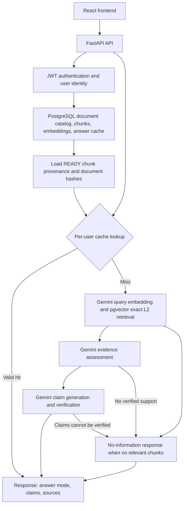
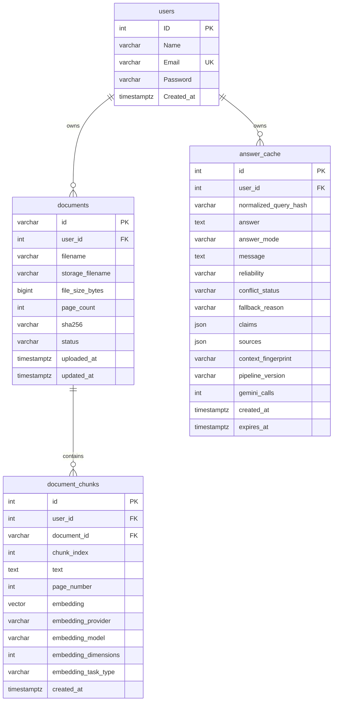

# Personalized AI Learning Assistant

A web application for asking questions about your own PDF study materials, with source excerpts and explicit answer modes.

> **Current scope:** Account-based PDF upload and retrieval-augmented question answering. The application does not currently provide learner profiles, recommendations, assessments, mastery tracking, or adaptive learning.

## What it does

Students can create an account, upload PDFs, and ask questions about the material they have uploaded. The backend temporarily processes each PDF, stores chunks and Gemini embeddings in PostgreSQL/pgvector, retrieves passages for the authenticated user, and uses Gemini to assess evidence, draft claims, and verify the claims against their cited passages.

Responses distinguish among:

- **Document supported** — claims are generated from retrieved passages and returned with source excerpts and claim-level citations.
- **Insufficient confidence** — returned with a clear no-information message when no verifiable document-grounded answer can be produced. Gemini is never called to answer from general knowledge.
- **Temporary processing error** — evidence-assessment or answer-generation API failures return HTTP 503 so they are not mistaken for missing document information.

Claim verification is model-assisted. The backend checks response structure and citation provenance, but cannot mathematically prove that a passage entails a claim or guarantee the model's factual correctness.

## Current features

- Account signup, login, logout, and authenticated user lookup.
- JWT authentication in an HttpOnly cookie, with CSRF token checks and exact Origin validation for unsafe browser requests.
- PDF upload and text extraction by page using `pypdf`.
- Character-based text chunks (1,000 characters, with 200-character overlap) and Gemini `gemini-embedding-001` embeddings (768 dimensions, normalized).
- Per-user PostgreSQL/pgvector exact L2 retrieval, limited to the five nearest READY chunks and a configuration-matched calibrated distance cutoff.
- Evidence assessment, claim generation, model-assisted claim verification, source excerpts, and disclosure of detected contradictions.
- Document-supported and no-information response modes; technical generation failures are returned as HTTP errors.
- Exact answer caching scoped to the user, normalized query, current retrieval context, and pipeline fingerprint.
- PostgreSQL persistence for accounts, document metadata, chunks, embeddings, and answer-cache records, managed through Alembic migrations.

### Current API

| Method | Endpoint | Purpose |
|---|---|---|
| `GET` | `/users/csrf` | Bootstrap the browser CSRF token. |
| `POST` | `/users/signup` | Create an account. |
| `POST` | `/users/login` | Authenticate and set cookies. |
| `GET` | `/users/me` | Return the authenticated user profile. |
| `POST` | `/users/logout` | Expire authentication and CSRF cookies. |
| `POST` | `/documents/upload` | Upload and index one PDF for the authenticated user. |
| `GET` | `/documents` | List the authenticated user's documents. |
| `GET` | `/documents/{document_id}` | Return details for one document owned by the authenticated user. |
| `DELETE` | `/documents/{document_id}` | Delete one owned document and its chunks. |
| `POST` | `/chat/query` | Ask a question and receive an answer, mode, claims, and sources. |

## API examples

The following payloads are illustrative examples of the current schemas, not captured production data. Cookie-authenticated unsafe requests require the `access_token` HttpOnly cookie, the signed `csrf_token` cookie, an exact allowed `Origin`, and a matching `X-CSRF-Token` header. The frontend obtains the CSRF token from `GET /users/csrf` (or the successful login response), keeps the header value in memory, and sends requests with credentials. JavaScript does not read the JWT cookie.

### Ask a question

`POST /chat/query` accepts a JSON body containing one `query` string:

```json
{
  "query": "What does gradient descent change during training?"
}
```

A representative document-supported response follows. `source.text` is a placeholder for an excerpt from the authenticated user's uploaded PDF.

```json
{
  "answer": "Gradient descent updates model parameters in the direction that reduces the loss.",
  "answer_mode": "DOCUMENT_SUPPORTED",
  "message": null,
  "reliability": "HIGH",
  "conflict_status": "NONE",
  "fallback_reason": null,
  "claims": [
    {
      "text": "Gradient descent updates model parameters in the direction that reduces the loss.",
      "classification": "SUPPORTED",
      "sources": [
        {
          "reference": "passage-example",
          "source": "course-notes.pdf",
          "page": 4,
          "text": "[Retrieved excerpt supporting this claim]"
        }
      ]
    }
  ],
  "sources": [
    {
      "reference": "passage-example",
      "source": "course-notes.pdf",
      "page": 4,
      "text": "[Retrieved excerpt supporting this claim]"
    }
  ]
}
```

If the user's documents do not provide relevant evidence, the API returns `INSUFFICIENT_CONFIDENCE`, no citations, and a plain-language message. If the documents contain only part of the answer, supported claims may be returned with a disclosure describing missing information. Gemini/API failures return HTTP 503. A document-supported label describes the selected pipeline path; model-assisted verification is not a guarantee of correctness.

For example, a no-information response has this shape:

```json
{
  "answer": "No relevant information was found in your uploaded documents to answer this question.",
  "answer_mode": "INSUFFICIENT_CONFIDENCE",
  "message": null,
  "reliability": "LOW",
  "conflict_status": "NONE",
  "fallback_reason": "NO_SUFFICIENT_DOCUMENT_EVIDENCE",
  "claims": [],
  "sources": []
}
```

### Upload a PDF

`POST /documents/upload` expects `multipart/form-data` with a field named `file`. The browser frontend adds the authentication cookies and CSRF header automatically. For a manual client, provide the authenticated cookies, matching CSRF header, and allowed Origin as described above.

```text
Content-Disposition: form-data; name="file"; filename="course-notes.pdf"
Content-Type: application/pdf

[PDF file bytes]
```

On success the endpoint returns HTTP `201 Created`:

```json
{
  "message": "Document uploaded and processed successfully",
  "filename": "course-notes.pdf"
}
```

Verified errors include `400` for an empty or invalid PDF, `401` for missing or invalid authentication, `403` for a failed Origin/CSRF check, `409` when that user already has a document with the same display filename, `413` when a file, page count, or per-user storage limit is exceeded, and `422` when the required multipart `file` field is absent. Unexpected upload processing errors return a generic `500`; incomplete document deletions return `503` and remain retryable. Defaults are 20 MiB per file, 250 pages per PDF, and 200 MiB of PDFs per user. Configure them with `MAX_PDF_UPLOAD_SIZE_BYTES`, `MAX_PDF_PAGE_COUNT`, and `MAX_USER_PDF_STORAGE_BYTES`.

## Usage walkthrough

1. Create an account or log in. The browser obtains a CSRF token before submitting unsafe requests.
2. Open **Documents** and upload a PDF. The interface reports the upload and indexing stages; processing extracts text and builds the user's index. The document appears in the account's document library and can be deleted there.
3. Wait for indexing to finish, then open the chat workspace.
4. Ask a question about the uploaded material.
5. Read the answer mode and disclosure. **Document supported** means claims were built from retrieved passages; **not found in your documents** means no verifiable document-supported answer was available. Technical API failures appear as retryable errors.
6. For document-supported claims, select a citation to inspect its source filename, page (when available), and retrieved excerpt.

Factual chat answers are limited to retrieved content from the authenticated user's uploaded documents.

## Application screenshots

No genuine application screenshots, GIFs, or videos are currently checked into the repository. Add screenshots here when captured from the running application; the following views would communicate the current workflow:

- Landing page.
- Login and signup interfaces.
- Main chat workspace.
- PDF upload and indexing workflow.
- Document-supported answer with citations and an excerpt open.
- No-information response when the uploaded documents do not answer the question.

## Architecture



The cache lookup follows loading the user's READY chunk provenance and document hashes. A valid hit avoids query embedding and vector search. There is no broader-retrieval or general-knowledge fallback.

## RAG and document processing

1. The authenticated user uploads a PDF. The backend streams it to a temporary file, validates it, and records its hash and `PROCESSING` status in PostgreSQL.
2. `pypdf` extracts text from pages. Pages with no extractable text do not produce chunks.
3. The local character splitter divides each page into chunks up to 1,000 characters with 200-character overlap; page and filename metadata are retained.
4. Gemini creates 768-dimensional normalized `RETRIEVAL_DOCUMENT` embeddings. Chunks, vectors, and the transition to `READY` are committed together in PostgreSQL.
5. A question is embedded with `RETRIEVAL_QUERY`; pgvector's `<->` operator runs exact L2 search restricted to the authenticated user's READY documents, returning at most five chunks. Runtime does not apply a calibrated distance cutoff.
6. Gemini drafts claims directly from the retrieved passages and separately verifies each claim against its cited passages. The backend constructs citations from those retrieved passages and drops or qualifies claims according to verification.
7. If there is no relevant support or the generated claims cannot be verified, the API returns a no-information response. If an external model call fails, the API returns HTTP 503 instead of disguising the failure as missing information.

The checked-in calibration artifact is retained for offline retrieval evaluation only and is not required by runtime.

PostgreSQL is the source of truth for document metadata, chunks, vectors, and answer cache. Upload failures roll back all chunks; incomplete `PROCESSING` documents are marked `FAILED` at startup. Deletion marks the document `DELETING`, invalidates that user's cache, and deletes the document and its chunks in a transaction. Original PDFs exist only in a temporary upload path during processing.

## Security and data isolation

- The authenticated identity comes from the server-validated JWT `sub` claim; request-supplied user IDs are not used to select a user's private store.
- JWTs are held in HttpOnly cookies and are not exposed to frontend JavaScript.
- Unsafe cookie-authenticated requests require a valid signed CSRF token and an exact configured Origin. CORS is configured with explicit origins and credentials.
- Retrieval SQL filters on both chunk and document `user_id` and requires document status `READY`; the database also has a composite tenant/document foreign key. PostgreSQL RLS is not enabled: application filtering remains mandatory, and RLS was not selected because Neon connection pooling and transaction-scoped tenant context would add complexity without replacing these predicates.
- The answer cache stores generated answers and source data in PostgreSQL. It must be treated as private user content.

These controls reduce accidental cross-user access but are not a claim of complete or production-certified security. Use an appropriately restricted database account in deployed environments.

## Answer cache

The cache uses a hash of the query after Unicode NFC normalization, whitespace collapsing, and case folding; punctuation remains significant. It is not semantic caching. Cache identity includes the authenticated user, hashes of all READY documents, and a fingerprint of prompts, generator model, embedding provider/model/dimensions, document and query task types, normalization, exact L2 metric, top-k, and calibration threshold.

Before returning a cached document answer, the backend validates the response schema and checks that its source excerpts and claim citations match current chunks belonging to READY documents for that user. It may also cache legitimate no-information responses, but never technical failures. Cache entries expire after 24 hours by default; set `ANSWER_CACHE_TTL_SECONDS` to change the lifetime. Cache database errors fall back to the normal RAG path.

A cache lookup occurs after current chunk provenance and READY-document hashes are loaded, before query embedding and pgvector retrieval. A valid hit skips retrieval and Gemini calls. Any READY-document content change or pipeline change invalidates reuse; cache database errors proceed through normal retrieval and answering.

## Technology stack

### Runtime

- **Frontend:** React 18, React Router, Redux Toolkit, Axios, Parcel, CSS Modules, React Markdown.
- **API:** Python, FastAPI, Pydantic, SQLAlchemy, PyJWT, `pwdlib`.
- **Database and migrations:** PostgreSQL, SQLAlchemy, Alembic.
- **Document/RAG:** `pypdf`, local character chunking, Google Gen AI SDK embeddings, PostgreSQL with pgvector.
- **Generation:** Google Gen AI SDK and Gemini (`gemini-3.6-flash`, as configured in the current source). Runtime generation and embedding requests have a finite 900-second client timeout; Gemini provider-side deadlines can still return HTTP 504.
- **Storage:** PostgreSQL stores document metadata, text chunks, vectors, and answer cache; PDFs are temporary processing files only.

### Development and tests

- Backend tests use Python `unittest` and FastAPI's test client.
- Frontend tests use Jest and React Testing Library.
- Retrieval and answer-validation evaluation scripts use JSON fixtures.

The project does not currently use a hosted vector database, Redis, or a recommendation model in its running application.

## Database schema

The PostgreSQL schema contains accounts, a per-user document catalog, pgvector document chunks, and exact-answer-cache records. Chunk rows have a composite foreign key to the matching `(document_id, user_id)` pair, preventing tenant/document mismatch, and cascade with document deletion. The unique cache key is `(user_id, normalized_query_hash, context_fingerprint, pipeline_version)`.



`users.ID` is an integer primary key; `documents.id` is a 36-character string primary key. `document_chunks` stores a 768-dimensional pgvector vector and has unique `(document_id, chunk_index)` positions and a composite tenant/document foreign key. `answer_cache` is indexed by user and expiry. PDFs are temporary files and are not a persistence layer.

## Setup

### Prerequisites

- Python 3.10 or newer, with versions compatible with `Backend/requirements.txt`.
- PostgreSQL, with a database created for this application.
- Node.js and npm, with versions compatible with `Frontend/package-lock.json`.
- A Gemini API key for live answer generation.

### Backend

In PowerShell, from the repository root:

```powershell
cd Backend
py -m venv .venv
.\.venv\Scripts\Activate.ps1
python -m pip install --upgrade pip
pip install -r requirements-dev.txt
Copy-Item .env.example .env
```

`requirements-dev.txt` includes the runtime dependencies from `requirements.txt` and adds development/test tools such as HTTPX and pytest. For a runtime-only install, use `pip install -r requirements.txt` instead.

For local development, edit `Backend/.env` and set the required values. The example file contains placeholders only; never commit real secrets. In production, configure environment variables through the hosting provider's environment-variable settings rather than uploading a local `.env` file.

| Variable | Purpose |
|---|---|
| `APP_ENV` | `development`, `test`, or `production`; must be explicit. |
| `DATABASE_URL` | SQLAlchemy PostgreSQL connection used by the API and Alembic. |
| `LLM_API_KEY` | Gemini API key used for answers and embeddings. Required in production; startup validates its presence but does not call Gemini. |
| `EMBEDDING_PROVIDER` | `gemini` (currently the supported provider). |
| `EMBEDDING_MODEL` | `gemini-embedding-001`. |
| `EMBEDDING_DIMENSIONS` | `768`; must match the pgvector column and calibration configuration. |
| `SECRET_KEY` | JWT signing secret. |
| `ALGORITHM` | JWT algorithm (the example uses `HS256`). |
| `ACCESS_TOKEN_EXPIRE_MINUTES` | JWT lifetime. |
| `CSRF_SECRET_KEY` | Dedicated random CSRF signing secret, at least 32 bytes and different from the JWT secret. |
| `CSRF_TOKEN_TTL_SECONDS` | CSRF token lifetime; default shown in the example is 3600 seconds. |
| `CORS_ALLOWED_ORIGINS` | Comma-separated exact frontend origins; production requires explicit origins. |
| `COOKIE_SECURE`, `COOKIE_SAMESITE`, `COOKIE_DOMAIN` | Cookie behavior; production requires secure cookies, and `SameSite=None` requires Secure. `COOKIE_DOMAIN` can be empty for local development. |
| `ANSWER_CACHE_TTL_SECONDS` | Answer-cache lifetime; default is 86400 seconds if unset. |
| `MAX_PDF_UPLOAD_SIZE_BYTES` | Per-file upload limit; default is 20 MiB. |
| `MAX_PDF_PAGE_COUNT` | Page limit; default is 250. |
| `MAX_USER_PDF_STORAGE_BYTES` | Per-user PDF storage limit; default is 200 MiB. |
| `RATE_LIMIT_ENABLED` | Enables process-local limits (enabled by default outside tests). |
| `RATE_LIMIT_TRUST_CF_CONNECTING_IP` | Set `true` on Render production to use its Cloudflare-overwritten `CF-Connecting-IP` visitor header. The app ignores `X-Forwarded-For`. |
| `RATE_LIMIT_LOGIN_REQUESTS`, `RATE_LIMIT_LOGIN_WINDOW_SECONDS` | Login attempts per client IP/window; defaults to 10 per 900 seconds. |
| `RATE_LIMIT_SIGNUP_REQUESTS`, `RATE_LIMIT_SIGNUP_WINDOW_SECONDS` | Signups per client IP/window; defaults to 5 per 3600 seconds. |
| `RATE_LIMIT_UPLOAD_REQUESTS`, `RATE_LIMIT_UPLOAD_WINDOW_SECONDS` | Uploads per authenticated user/window; defaults to 5 per 3600 seconds. |
| `RATE_LIMIT_CHAT_REQUESTS`, `RATE_LIMIT_CHAT_WINDOW_SECONDS` | Chat requests per authenticated user/window; defaults to 20 per 60 seconds. |
| `RATE_LIMIT_MAX_BUCKETS` | Maximum in-memory rate-limit identities; defaults to 20,000. New identities receive 429 while all slots remain active. |

Generate secrets with a cryptographically secure random generator. Do not use example values or reuse the JWT key for CSRF signing.

Rate limiting is held in process memory to match the single-process Render deployment. It is concurrency-safe and bounded, but counters reset on process restart and are not shared across multiple instances. Keep one backend instance if these limits are relied on. Set `RATE_LIMIT_TRUST_CF_CONNECTING_IP=true` in Render; the limiter trusts that header only when explicitly enabled and never parses caller-controlled `X-Forwarded-For` values.

Create the PostgreSQL database using your local PostgreSQL administration workflow, then put its SQLAlchemy URL in `DATABASE_URL`. The application does not provision PostgreSQL roles or databases automatically.

For a **new, empty database**, apply the existing migrations from the `Backend` directory:

```powershell
alembic upgrade head
alembic current
alembic history
```

For an **existing database that already has `public.users` but has no Alembic revision recorded**, do not run the baseline upgrade directly against that table. First compare its schema with `fa11c95537c7_baseline_users_schema.py`. If it matches the baseline, record only that baseline and then apply later revisions:

```powershell
alembic stamp fa11c95537c7
alembic upgrade head
alembic current
```

This allows Alembic to create later tables such as `answer_cache` and `documents` without recreating `users`. Do not stamp `head` unless the existing database has been checked against every revision it would mark as applied.

Start the API from `Backend`:

```powershell
uvicorn App.main:app --reload
```

### Frontend

In a second terminal:

```powershell
cd Frontend
npm ci
Copy-Item .env.example .env
npm start
```

The Parcel development server defaults to `http://localhost:1234`. Set `API_BASE_URL` in `Frontend/.env` if the backend is at a different address. `CSRF_BOOTSTRAP_TIMEOUT_MS` defaults to 10,000 ms and is capped at 30,000 ms.

## Tests and evaluation

From `Backend`:

```powershell
python -m unittest discover -s tests -v
python scripts/evaluate_rag.py
python scripts/evaluate_rag_answers.py
```

The retrieval evaluator calls the configured Gemini embedding API and therefore requires `LLM_API_KEY`; it makes provider requests. It writes a calibration artifact only when explicitly run with `--write-calibration`; review results before replacing the artifact. The checked-in calibration is for offline evaluation only; runtime retrieval does not apply a distance cutoff. The bundled 40-case synthetic retrieval set is a smoke evaluation, not a reliable production calibration. No application startup Gemini call is made.

The answer evaluator is deterministic and makes no Gemini calls. It tests validators against manually authored answer/verifier fixtures. Both evaluation datasets are small and synthetic; their metrics are not measurements of live Gemini accuracy or real student outcomes. The optional `python scripts/evaluate_rag_answers.py --live-sample` makes live Gemini requests using four synthetic examples and may incur API usage.

From `Frontend`:

```powershell
npm test -- --runInBand
npm run build
```

Tests mock external model calls and use local test fixtures where appropriate. They do not establish live-provider accuracy or multi-browser guarantees.

## Storage and deployment considerations

PostgreSQL is authoritative for document ownership, lifecycle status, chunks, and embeddings. Only upload work files use local temporary storage and are removed on success, failure, and startup recovery. Existing MiniLM FAISS indexes and mock catalog rows are not migrated or deleted automatically; they are not read by the runtime. Re-upload any PDF needed in the new schema.

At startup, interrupted `PROCESSING` records and READY records without chunks are marked `FAILED`; `DELETING` rows are completed using database cascades. Startup recovery performs no vector manifest or legacy file recovery.

For Render, set `DATABASE_URL` to the Neon connection string, `LLM_API_KEY`, `EMBEDDING_PROVIDER=gemini`, `EMBEDDING_MODEL=gemini-embedding-001`, `EMBEDDING_DIMENSIONS=768`, `APP_ENV=production`, strong independent `SECRET_KEY` and `CSRF_SECRET_KEY`, `ALGORITHM=HS256`, `ACCESS_TOKEN_EXPIRE_MINUTES=30`, `COOKIE_SECURE=true`, `COOKIE_SAMESITE=lax`, and `CORS_ALLOWED_ORIGINS` to the frontend HTTPS origin. With the Render root directory set to `Backend`, use build command `pip install -r requirements.txt` and start command `alembic upgrade head && uvicorn App.main:app --host 0.0.0.0 --port $PORT`. No durable disk is needed for vector data. After the calibration artifact matches Gemini and L2, upload a PDF, ask a question that should cite it, restart/redeploy the backend, then ask the same question and confirm its citation remains available. The checked-in MiniLM calibration is rejected, so retrieval is intentionally unavailable until a reviewed Gemini calibration is supplied. No live deployment is claimed.

Run local automated checks from `Backend` with `python -m unittest discover -s tests -v`; the suite mocks Gemini and needs no paid API calls. For the real vector operator against a migrated PostgreSQL/pgvector test database, set `PGVECTOR_TEST_DATABASE_URL` and run `python -m unittest tests.test_pgvector_integration -v`. The integration test wraps all temporary rows in a transaction and rolls it back. Do not point it at an important database. The Gemini evaluation command `python scripts/evaluate_rag.py --write-calibration` makes real embedding API requests; review its limited synthetic validation results before using the generated artifact.

## Current limitations

### Product limitations

- No persistent backend chat history; chat state is held in frontend memory and does not survive a page reload.
- No document replacement API. Users can list and delete cataloged documents; each upload has a size limit, page limit, and per-user storage quota.

### RAG limitations

- PDF text extraction only; there is no OCR pipeline for scanned pages or general document understanding.
- Chunk size/overlap and top-five retrieval are fixed. Gemini vectors use 768-dimensional normalization and pgvector exact L2 search. The checked-in relevance calibration is MiniLM-based and rejected; the Gemini synthetic fixture is too small to establish a reliable production threshold without broader evaluation data.
- There is no broader-retrieval or general-knowledge fallback. The assistant returns no-information when retrieved content cannot support a verified answer.
- Gemini claim verification is model-assisted, not a deterministic entailment proof or correctness guarantee.
- Evaluation fixtures are small and synthetic; they do not establish live Gemini accuracy or learning outcomes.

### Operational limitations

- Gemini embedding requests run synchronously during ingestion and query retrieval. Provider outages do not prevent backend startup, but embedding-dependent operations fail with explicit bounded retries. Exact vector search has not yet been benchmarked against the production corpus.

## Roadmap

Planned work is separate from current functionality. Future directions may include persistent conversation/document management, better document support and evaluation, and—after collecting suitable consent-aware learning data—learner profiles, assessments, mastery tracking, and recommendations. None of those learning-personalization features are currently implemented.

## Repository layout

```text
Backend/
  App/
    Routers/       Auth, chat, signup, and document-upload routes
    base.py        Shared SQLAlchemy declarative base
    models.py      users, documents, document_chunks, and answer_cache tables
    schemas.py     Request and response schemas
    database.py    SQLAlchemy engine, sessions, and get_db dependency
    csrf.py        CSRF and CORS configuration
  Rag/             temporary PDF ingestion, pgvector retrieval, answer generation, cache
  alembic/
    versions/      User, document-catalog, and answer-cache migrations
  scripts/         RAG evaluators and legacy catalog/vector-store migration tools
  tests/
    fixtures/      Synthetic retrieval and answer-validation datasets
  .env.example     Backend configuration template
  alembic.ini      Alembic configuration (credentials are read from .env)
  requirements.txt Runtime Python dependencies
  requirements-dev.txt Runtime dependencies plus development/test tools

Frontend/
  src/
    components/    Reusable interface components
    features/      Page-level views for auth, chat, dashboard, documents, and settings
    layouts/       Public and authenticated application layouts
    routes/        Route configuration and access guards
    services/      Axios client and API services; service tests
    store/
      slices/      Redux auth, chat, document, and UI state
    styles/        Global styles and design tokens
  .env.example     Frontend configuration template
  package.json     Parcel, Jest, and frontend scripts
  package-lock.json Locked npm dependency tree
```

Page components are organized under `Frontend/src/features/`; there is no separate `pages/` directory. Component, chat-page, and service tests are colocated in `__tests__/` directories. The `Data` and `Storage` paths contain runtime user files and are not PostgreSQL tables.

## License

No `LICENSE` file is present in this repository, so it currently has no explicit open-source license. Do not assume that reuse or redistribution is permitted under a particular license.

## Contributing

Contributions can be prepared as follows:

1. Fork the repository and create a feature branch.
2. Follow the backend and frontend setup instructions above.
3. Make a focused change and add or update relevant tests.
4. Run the backend and frontend test commands in [Tests and evaluation](#tests-and-evaluation).
5. Open a pull request describing the change and its verification.

The repository has no explicit license yet; this section describes a contribution workflow and does not grant licensing terms.
